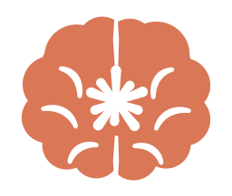
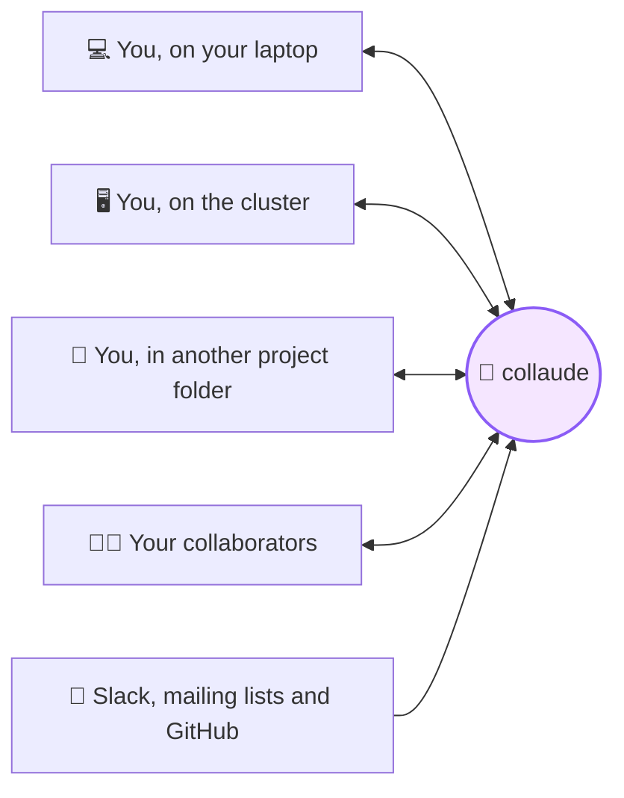

<div align="center">



# collaude

### One memory for every Claude you run.

A Claude Code plugin that gives all your sessions a shared, searchable brain:<br>
across folders, across machines, and across your team.

</div>

---

Every Claude Code session turns up something worth keeping: a bug's real cause, an approach that failed, a decision and the reason for it. Then the session ends and it's gone. Open Claude in another folder, on your other computer, or hand the project to a colleague, and you start from zero.

**collaude remembers.** As you work, it picks out what's worth knowing later and adds it to a central memory. Every session connected to that memory starts out knowing it, and can search the rest.



## One brain, wherever you work

- **Across folders.** The analysis repo, the paper draft and the scratch directory can share one memory. What you learned debugging in one is there when you're writing in another.
- **Across machines.** Work on your laptop in the morning and on the cluster in the afternoon. Both connect to the same memory, so neither has to be told twice.
- **Across your team.** Point a group at the memory and your collaborators' sessions draw on it too. Nobody re-runs the dead end you already tried.

A memory belongs to a *group*. A group can be just you, a project, or a whole lab.

## Why collaude

**🪄 Nothing to remember.** No notes to write and no wiki to keep up. collaude runs in the background through Claude Code hooks, and you keep working as usual.

**🔎 Answers, not transcripts.** Each session becomes a few short memories, typically zero to three: findings, dead ends, decisions, methods and gotchas. Search ranks them by relevance and by how recent they are.

**🧾 Every memory can be traced.** A memory records which person, machine and folder it came from, when, the git branch and commit, and a verbatim quote from the conversation behind it. Memories can be corrected or retracted, but nothing is silently deleted.

**🔒 Private by default.** Groups are closed. The database itself enforces who can read what, so another group's memories never reach your session. Type `#offrecord` in any message and that session is never recorded.

**💬 Slack, email and GitHub too.** Connect your group's channels, mailing lists and repos, and the decisions buried in long threads and issue discussions become searchable memories that link back to the original messages.

**🐘 Runs on plain Postgres.** It needs no extensions and no vendor lock-in. Run it on a laptop, on your own server, or with any hosted Postgres provider.

## How it works

1. **You work.** Use Claude Code as you always do, in any folder linked to a group.
2. **collaude listens.** When a session ends or compacts, a background job takes the new part of the conversation, redacts secrets, and asks a small model what is worth remembering.
3. **Every session benefits.** The memories are stored with their provenance. Each new session in the group, on any machine and by anyone in it, starts by seeing the latest memories, and Claude knows to search the rest before it repeats work.

## Get started

You need [uv](https://docs.astral.sh/uv/) and a personal connection string from whoever runs your database. To run the database yourself, see [For admins](#for-admins).

**1. Install the plugin** in Claude Code:

```
/plugin marketplace add andycasey/collaude
/plugin install collaude@collaude
```

**2. Put the `collaude` command on your path.** Claude Code keeps the plugin at `~/.claude/plugins/marketplaces/collaude`, and the command is a single script inside it that runs itself through uv:

```sh
mkdir -p ~/.local/bin
ln -sf ~/.claude/plugins/marketplaces/collaude/plugins/collaude/bin/collaude.py ~/.local/bin/collaude
collaude --help        # if this isn't found, add ~/.local/bin to your PATH
```

The link stays valid when the plugin updates. If you added the marketplace from a local clone instead, link to `plugins/collaude/bin/collaude.py` in that clone.

**3. Connect** to the database. The string is saved to `~/.config/collaude/config.json`, readable only by you.

```sh
collaude setup --dsn '<your connection string>'
collaude passwd        # optional: choose your own password
```

**4. Link a project** to a group, once per project:

```sh
cd ~/projects/my-project
collaude init my-group
git add .collaude.json && git commit -m "Share Claude memories with my-group"
```

That's it. Sessions in that folder now add to the group's memory and draw on it.

**On another machine,** repeat steps 1 to 3 with the same connection string. Because `.collaude.json` is committed, any clone of the project is already linked. **For another folder,** run `collaude init my-group` there too.

## Use it

Mostly you won't need to: Claude searches the memory on its own when it's relevant. Ask it *"have we looked at this before?"* and it will check. You can also use the command line:

```sh
collaude search "detection limit"                  # search this project's group
collaude search "zero point" --all-groups --kind dead_end
collaude recent -n 20
collaude show 42                                   # full text and provenance
collaude add --kind decision --title "..." --body "..."
collaude retract 42 --reason "bug in the binning"
collaude status
```

Memory kinds: `finding`, `dead_end`, `decision`, `method`, `data_note`, `gotcha`, `question`, `other`.

## Bring in Slack, email and GitHub

Connectors pull messages from the channels, mail folders and repos you choose, wait until a thread has gone quiet, and then distil it into memories that cite the original messages. Everything is set up from the command line, which checks your credentials before it saves anything.

```sh
collaude connector slack-manifest        # create the Slack app from this manifest
collaude connector add slack             # paste the bot token, then choose a group for each channel
collaude connector add email --host imap.example.org --user lists@example.org
collaude connector add email --oauth --user me@example.org --oauth-client-file client_secret.json   # Gmail
collaude connector add github            # press Enter to use your gh login, then name the repos

collaude connector list                  # what's connected, last sync, any errors
collaude search --messages "zero point"  # search the raw messages
```

Catch-up runs in the background whenever someone who holds the credentials starts a Claude session, so no server is needed. A lease in the database makes sure only one machine runs a connector at a time. Re-fetching a message never stores it twice, and a thread or channel that fails never blocks the others.

<details>
<summary><b>GitHub</b></summary>

Each issue or pull request is a thread: its opening post, its comments and its code-review comments. Bots such as Dependabot and CI are skipped.

At the token prompt, press Enter to use your [`gh`](https://cli.github.com/) login. collaude then asks `gh` for a token on each run and keeps no copy. Or paste a [fine-grained token](https://github.com/settings/personal-access-tokens/new) with read-only *Issues* and *Pull requests* access to the repos you want to share.

```sh
collaude connector add github --route 'my-org/analysis=my-group'
collaude connector route github https://github.com/my-org/paper my-group --backfill-days 60
```

Without `--route`, you're asked for `owner/repo=group` lines. `collaude connector sources github` lists every repo the token can see.

</details>

<details>
<summary><b>Gmail and Google Workspace</b></summary>

Gmail works with an [app password](https://myaccount.google.com/apppasswords), but many Workspace domains turn those off. Signing in with Google instead takes a one-time OAuth client, which you create yourself:

1. In [Google Cloud Console](https://console.cloud.google.com/), pick or create a project. A project in your organisation is best for a Workspace account.
2. Under **Google Auth Platform → Audience**, choose **Internal** for a Workspace account. For a personal Gmail account, choose **External** and add yourself as a test user.
3. Under **Clients**, create an OAuth client of type **Desktop app** and download its JSON.
4. Connect, and sign in when the browser opens:

   ```sh
   collaude connector add email --oauth --user me@example.org --oauth-client-file ~/Downloads/client_secret_….json
   ```

The host defaults to `imap.gmail.com`. If the browser runs on another machine, for example over SSH, open the printed link there and paste back the `http://127.0.0.1…` address it ends up on. To run the same mailbox from a second machine, use `collaude connector login email --oauth-client-file …`. The client JSON can be shared within your group, but the sign-in is stored only on the machine where it happened.

Google expires sign-ins after 7 days for an External app that is still in *Testing*. Publish the app to stop this, or run `collaude connector login email` again when `collaude connector list` reports the error.

</details>

<details>
<summary><b>More connector commands</b></summary>

```sh
# Non-interactive, e.g. for scripts
collaude connector add slack --secret-env SLACK_BOT_TOKEN --route '#my-channel=my-group'
collaude connector add email --host ... --user ... --secret-env MAILPW --route 'lists/my-list=my-group'

collaude connector sources slack                         # channels the credentials can see
collaude connector route slack '#new-channel' my-group --backfill-days 30
collaude connector unroute slack '#new-channel'
collaude connector login slack                           # a second person stores credentials too
collaude connector pause slack / resume slack
collaude connector rename slack lab-slack             # other machines pick up the new name by themselves
collaude connector remove slack                          # disconnect; ingested memories stay
collaude ingest                                          # run now instead of at the next session start
```

Tokens and passwords stay in `~/.config/collaude/secrets.json` on the machine where they were entered. Only the routing (which channel feeds which group) is stored in the database. Only a connector's creator can route it, and only to a group they belong to; any member of a group can unroute a channel from it.

Memories from a connector are credited to the person whose machine ingested them, and `collaude show` lists the original messages with their real authors and links.

The first run fetches 14 days of history (`--backfill-days`). Slack's free plan hides messages older than 90 days, so if your group might go that long without opening Claude, schedule `collaude ingest --stale-after 30 --quiet` with cron or launchd.

</details>

## What leaves your machine

| Where | What |
|---|---|
| **Anthropic**, through your own `claude` login | The new part of the session, with secrets redacted and noise removed. Your messages and Claude's replies are kept. Tool calls and their output are clipped short. Thinking, sub-agents and system text are dropped. |
| **Your group's database** | Only the resulting memories and their provenance. Condensed transcripts are uploaded only if the project turns on `share_excerpts`. |

Redaction catches private keys, common API tokens, and passwords in URLs and config-style assignments. Treat it as a safety net, not a guarantee; `#offrecord` is the reliable switch.

## Configuration

`.collaude.json` sits in the project folder and is committed alongside the code:

```json
{
  "group": "my-group",
  "capture": true,
  "share_excerpts": false,
  "recent_on_start": 8,
  "checkpoint_minutes": 0
}
```

| Option | What it does |
|---|---|
| `group` | The group this folder belongs to. |
| `capture` | Set to `false` to read the group's memories here without adding any. |
| `share_excerpts` | Also upload the condensed, redacted transcript, so collaborators can see the context behind a memory. Off by default. |
| `recent_on_start` | How many recent memories Claude sees when a session starts. |
| `checkpoint_minutes` | Also capture a session every this many minutes while it runs. This is useful when sessions stay open for days. `0` (the default) captures only when a session compacts or ends. |

Logs are written to `~/.local/state/collaude/collaude.log`. If the database can't be reached, the capture is retried next time.

## For admins

Give collaude any PostgreSQL 14+ server and a connection string for a role that can create roles and schemas. Each person gets their own database login, and row-level security limits everything they read or write to their own groups.

```sh
export COLLAUDE_ADMIN_DSN='postgresql://...'

collaude admin migrate                                   # create or upgrade the schema
collaude admin add-group my-group --name "My research group"
collaude admin add-user alice@example.org --name "Alice" --group my-group
#   -> prints Alice's personal connection string; send it to her privately
collaude admin add-member alice@example.org another-group
collaude admin remove-member alice@example.org my-group
collaude admin deactivate-user alice@example.org         # revokes login, keeps her memories
collaude admin list-users
```

To try it locally:

```sh
brew install postgresql@16 && brew services start postgresql@16
createdb collaude
export COLLAUDE_ADMIN_DSN=postgresql://localhost/collaude
```

When you're ready to share, run it on a server your collaborators can reach (on your network, over a VPN, or hosted), and use TLS if it's reachable from outside. Moving later is a `pg_dump` of the `collaude` schema and its roles.

## Roadmap

- **Meaning-based search** with `pgvector`, blended with full-text ranking.
- **More connectors:** arXiv and ADS alerts, GitHub Discussions, document comments. A connector is a small class in `bin/collaude_connectors.py`.
- **Several groups per folder.** Today a folder belongs to one group, and other groups are reachable with `--all-groups`.

Removing someone from a group stops what they can read from then on, but it can't take back what they've already seen. Extraction quality depends on `prompts/extract.md`, so tune it for your field. Each memory records the extractor version that wrote it.

## Development

```sh
# unit tests
uv run --with pytest --with 'psycopg[binary]' pytest tests

# full suite against a disposable server (creates and drops its own database and roles)
COLLAUDE_TEST_ADMIN_DSN=postgresql://localhost/postgres \
  uv run --with pytest --with 'psycopg[binary]' pytest tests

# try the plugin without installing it
claude --plugin-dir plugins/collaude
```
